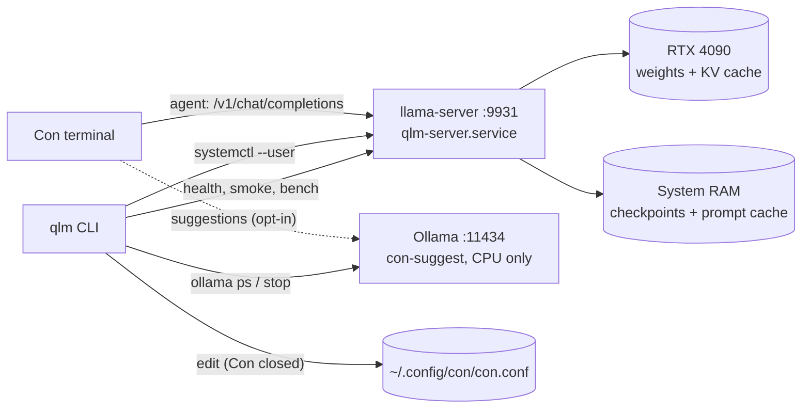

# qlm: architecture

`qlm` is a command-line tool that installs, runs, checks and tunes Qwen3.8-27B (Q4_K_M) on this one machine, as the local backend for the Con terminal. This document says what the tool is made of and how the parts fit. Use it to review the design before any code is written, and to settle questions later. The reasons behind each choice are in the ADRs it links to.

- **Status:** Accepted (2026-10-16)
- **Date:** 2026-10-16
- **Machine:** i9-13900KF (no iGPU), 62 GiB DDR5, NVIDIA RTX 4090 with 24,564 MiB of video memory (VRAM) (compute capability 8.9), driver 615.78, CUDA (NVIDIA's GPU toolkit) 13.4, Arch Linux

## What it sets up

| Piece | Choice | Why |
|---|---|---|
| Runtime | llama.cpp `llama-server`, built from tag `b11669` (2026-10-15) with CUDA for sm_89 | [ADR 0001](adr/0001-runtime-llama-cpp-server.md) |
| Model | `unsloth/Qwen3.8-27B-GGUF` `UD-Q4_K_M`, plus its MTP draft file | [ADR 0002](adr/0002-model-file-and-vram-budget.md) |
| Default settings | 64k context, 8-bit key/value (KV) cache, all layers on GPU, multi-token prediction (MTP) on, one slot, no vision projector | [ADR 0002](adr/0002-model-file-and-vram-budget.md) |
| Con link | `openaicompatible` provider at `http://127.0.0.1:9931/v1`; suggestion model off | [ADR 0003](adr/0003-con-integration.md) |
| Tooling | One Python stdlib CLI, pytest, systemd user service | [ADR 0004](adr/0004-python-stdlib-cli-and-systemd-user-unit.md) |

Expected results are estimates until `qlm bench` measures them:

| Measure | Estimate | Source |
|---|---|---|
| Server VRAM | ~20.3 GiB (22.8 of 23.99 GiB with the desktop) | ADR 0002 arithmetic |
| Generation, MTP on | 70–130 tok/s (higher when editing code, lower on new reasoning) | 4090 test of Qwen3.6-27B Q4_K_M: 47 → 133 tok/s |
| Generation, MTP off | 45–48 tok/s | Same test |
| Prompt processing | 1,500–2,500 tok/s | Estimate for a dense 27B model on a 4090 |
| First Con turn | 6–9 s before output starts | ~13k-token fixed prompt at the rate above |

## How the parts connect

The diagram shows who calls whom at run time. Con sends agent requests to llama-server only. If you opt in, its background suggestion requests go to a small CPU-only Ollama model. `qlm` controls the server through systemd and checks it over HTTP.



## Where things live

| Path | Contents | Written by |
|---|---|---|
| `~/dev/qwen-local/` | This repo: `bin/qlm`, the `qlm/` package, `profiles/`, `systemd/`, `tests/`, `docs/` | You |
| `~/.local/bin/qlm` | Symlink to `bin/qlm`. `~/.local/bin` is not on `PATH` yet, so `qlm doctor` says how to add it. | `qlm install` |
| `~/.cache/qlm/llama.cpp/` | llama.cpp git checkout | `qlm install` |
| `~/.local/opt/llama.cpp/<tag>/` | Built `llama-server` and `llama-bench`, one directory per tag | `qlm install`, `qlm update` |
| `~/.local/opt/llama.cpp/current` | Symlink to the active tag | Switched only after a check passes |
| `~/.local/share/qlm/models/` | The two GGUF files and `SHA256SUMS` | `qlm fetch` |
| `~/.config/qlm/active.env` | The active profile as `LLAMA_ARG_*` variables. `qlm install` writes the `agent` profile here, so it always exists. | `qlm install`, `qlm profile use` |
| `~/.config/systemd/user/qlm-server.service` | Service unit | `qlm install` |
| `~/.local/state/qlm/` | Bench results (JSON), `smoke/` holding one log per `qlm smoke` run, and `backups/` holding timestamped copies of `con.conf`. Both folders are mode 0700 and their files 0600. | `qlm bench`, `qlm smoke`, `qlm con`, `qlm suggest` |

## Commands

Each command does one job and exits non-zero on failure with a message that names the cause and the fix.

| Command | What it does | Done when |
|---|---|---|
| `qlm doctor` | Read-only preflight: driver and `nvidia-smi`, `nvcc` and host compiler, disk space, port 9931 free, models loaded in Ollama, VRAM held by other processes, `~/.local/bin` on `PATH`, Con config keys | Prints a pass/fail line per check |
| `qlm install [--tag b11669] [--rebuild]` | Resolve the tag to its commit and stop unless it matches ADR 0001, then check out that commit, build with `-DGGML_CUDA=ON -DCMAKE_CUDA_ARCHITECTURES=89 -DBUILD_SHARED_LIBS=OFF`, and retry the configure step with `-DCMAKE_CUDA_HOST_COMPILER=/usr/bin/g++-15` if `nvcc` rejects the host compiler. Copy the new binaries in under staged names; they replace the old ones only after the `--help` check passes. Then switch `current`, install the unit and symlink, write the `agent` profile to `active.env`, and create the API key file (ADR 0003). An installed tag skips the build unless `--rebuild` is given. `--tag` accepts only the pinned tag until `qlm update` exists. | `llama-server --help` lists every variable the profiles use as `(env: NAME)`, and `draft-mtp` among the `--spec-type` values |
| `qlm fetch [--vision]` | Download the model and MTP files with resume from the pinned Hugging Face revision (`/resolve/<revision>/`), then check SHA-256 against the hashes recorded in ADR 0002, not hashes fetched at download time. `--vision` adds `mmproj-BF16.gguf`. After a run in which every file verified, write `SHA256SUMS`. | All hashes match the recorded ones |
| `qlm profile use <agent\|long\|vision>` | Render `active.env` from `profiles/<name>.env`, after checking that the model files it names exist. If the service is running, first run the Ollama and VRAM checks from `qlm start`, counting the running server's own VRAM as free, then restart it and wait and report as `qlm start` does | `active.env` matches the profile |
| `qlm start` | Check free VRAM (total minus used, from `nvidia-smi --query-gpu=memory.total,memory.used`) against the profile's `vram_gib` plus 0.5 GiB. Refuse if `ollama ps` shows a model using the GPU, and print the `ollama stop <name>` command. A CPU-only model such as `con-suggest` is allowed. Then clear any earlier start limit with `systemctl --user reset-failed`, start the service, wait for `/health` to return 200 (up to 180 s), and stop the unit if the wait runs out or the server exits, so it doesn't keep retrying | Reports the server's VRAM and load time |
| `qlm stop`, `qlm status`, `qlm logs [-n N] [-f]` | Wrap `systemctl --user` and `journalctl --user`. `status` adds VRAM, the profile, uptime, and the largest request so far (`llamacpp:n_tokens_max` from `/metrics`) against the context size. The pinned llama-server has no metric for the context in use right now, and `/slots`, which has it, stays off. | |
| `qlm smoke` | Eight API checks, listed below | All pass, or each failure is named |
| `qlm bench` | Measure prompt and generation speed, MTP acceptance, cache reuse and peak VRAM; save JSON and compare with the last run | Results saved under `~/.local/state/qlm/bench/` |
| `qlm con --print\|--apply\|--revert` | Show, write or undo the Con keys from ADR 0003. `--apply` refuses while Con is running (`pgrep -x con`; Con's binary is named `con`) and while the file has dashed `openai-compatible` keys. It backs up first with mode 0600, writes the new file atomically with the original's mode, sets the API key, and removes `con.agent.temperature` if set so the server's sampling applies. It leaves the suggestion model on when `qlm suggest --enable` pointed it at Ollama's `con-suggest`. `--revert` restores the newest backup. | `--apply` re-reads the file and finds exactly the expected values, or puts the old file back. Checking that Con's agent answers is a manual step. |
| `qlm suggest --enable\|--disable` | `--enable` creates the CPU-only `con-suggest` Ollama model and sets `con.agent.suggestion_model.enabled = true`, `.provider = "ollama"` and `.model = "con-suggest"`. `--disable` sets `enabled = false`. Same Con-running and backup rules as `qlm con`. | |
| `qlm update --tag <bN> --commit <sha>` | In this order: build the new tag beside the old one, check its commit and its `--help`, check free VRAM as `qlm start` does, switch `current` to it, restart, run `qlm smoke`. If smoke fails, switch `current` back and restart. If the service was stopped beforehand, it is stopped again at the end. Nothing is switched if the build, the checks or the VRAM preflight fail. | Smoke passes on the new tag, or the old tag is back in `current` |
| `qlm uninstall [--models]` | Stop and remove the unit, builds and symlinks; keep model files unless `--models` | |

### The `agent` profile

This is the default profile, as `profiles/agent.env`. llama-server reads each `LLAMA_ARG_*` variable as the matching command-line flag. `qlm install` checks every name against the built binary's `--help`, because names have changed between releases: in 2026 the MTP value of `--spec-type` changed from `mtp` to `draft-mtp`. The first line is a comment `qlm` reads for the VRAM preflight; llama-server ignores it.

```ini
# qlm: vram_gib=20.3
LLAMA_ARG_MODEL=%h/.local/share/qlm/models/Qwen3.8-27B-UD-Q4_K_M.gguf
LLAMA_ARG_SPEC_TYPE=draft-mtp
LLAMA_ARG_SPEC_DRAFT_MODEL=%h/.local/share/qlm/models/mtp-Qwen3.8-27B-Q4_0.gguf
LLAMA_ARG_SPEC_DRAFT_N_MAX=3
LLAMA_ARG_CTX_SIZE=65536
LLAMA_ARG_N_GPU_LAYERS=all
LLAMA_ARG_FIT=off
LLAMA_ARG_FLASH_ATTN=on
LLAMA_ARG_CACHE_TYPE_K=q8_0
LLAMA_ARG_CACHE_TYPE_V=q8_0
LLAMA_ARG_N_PARALLEL=1
LLAMA_ARG_MMPROJ_AUTO=false
LLAMA_ARG_CTX_CHECKPOINTS=32
LLAMA_ARG_CACHE_RAM=16384
LLAMA_ARG_JINJA=true
LLAMA_ARG_THINK=auto
LLAMA_ARG_ALIAS=qwen3.8-27b
LLAMA_ARG_HOST=127.0.0.1
LLAMA_ARG_PORT=9931
LLAMA_ARG_ENDPOINT_METRICS=true
LLAMA_ARG_ENDPOINT_SLOTS=false
LLAMA_ARG_UI=false
LLAMA_ARG_CORS_ORIGINS=http://qlm.invalid
LLAMA_ARG_API_KEY_FILE=%h/.config/qlm/api-key
LLAMA_ARG_TEMPERATURE=1.0
LLAMA_ARG_TOP_P=0.95
LLAMA_ARG_TOP_K=20
LLAMA_ARG_MIN_P=0.0
LLAMA_ARG_PRESENCE_PENALTY=0.0
```

The sampling values are Qwen's published settings for thinking mode. llama-server's own defaults differ (temperature 0.80, top-k 40, min-p 0.05), and Con sends no temperature (ADR 0003), so the server's values are the ones that apply. `%h` is expanded to the home directory when `qlm` renders `active.env`. These settings need a note:

- `LLAMA_ARG_THINK` is the variable for `--reasoning-format`. `auto` returns thinking in a separate `reasoning_content` field, which Con displays.
- `LLAMA_ARG_MMPROJ_AUTO=false` is the variable form of `--no-mmproj`.
- Context shift is off by default in llama-server, and the profile leaves it off. A request over the context limit fails instead of losing its start.
- The last four lines lock the server down for a desktop that also runs a browser. By default llama-server reflects any web page's `Origin` back with credentials allowed, so a page could drive the model and read the replies. `http://qlm.invalid` matches no real site. The API key, which no web page knows, also stops the plain POSTs a page can send without a CORS check, which would otherwise evict Con's cached prompt. The web UI and `/slots` are off because nothing here uses them. `/health` stays public without the key.

The `long` profile (`vram_gib=20.0`) sets the context to 98,304 and removes the three `SPEC_*` lines. The `vision` profile (`vram_gib=18.7`) sets the context to 32,768, removes `SPEC_*` and the `LLAMA_ARG_MMPROJ_AUTO=false` line, and sets `LLAMA_ARG_MMPROJ` to the projector file.

### The service unit

`qlm install` writes `~/.config/systemd/user/qlm-server.service`:

```ini
[Unit]
Description=llama-server for Qwen3.8-27B (qlm)
StartLimitIntervalSec=120
StartLimitBurst=3

[Service]
EnvironmentFile=%h/.config/qlm/active.env
ExecStart=%h/.local/opt/llama.cpp/current/bin/llama-server
Restart=on-failure
RestartSec=5

[Install]
WantedBy=default.target
```

The start limit stops systemd after three failed starts in two minutes. Without it, a profile that doesn't fit would restart every 5 s indefinitely, because systemd's default limit (5 starts in 10 s) is never reached at that delay. The unit is not enabled at login. `qlm start` starts it when you want the model, so the 20 GiB of VRAM stays free otherwise.

`bin/qlm` resolves its own real path (it is reached through a symlink), adds the repo root to `sys.path`, and calls `qlm.cli.main()`. That works under `python3 -I`, which ignores `PYTHONPATH` and the current directory.

### What `qlm smoke` checks

1. `GET /health` returns 200.
2. `GET /v1/models` lists `qwen3.8-27b`.
3. A one-tool request returns a `tool_calls` entry naming that tool, with arguments that parse as JSON and match the schema.
4. A two-step loop works: the tool result goes back to the model, and the final answer uses a value only that result contained.
5. The Anthropic endpoint `/v1/messages` returns a `tool_use` block for the same tool.
6. A thinking request returns `reasoning_content` separate from `content`.
7. MTP is active: the response's `timings` show accepted draft tokens above zero. This check runs only when the active profile sets `LLAMA_ARG_SPEC_TYPE`.
8. A request without the API key gets 401, which shows the lock-down described under the `agent` profile is in effect.

The exact tool schemas, prompts and timeouts are in the spec on [issue #4](https://github.com/Towerism/qwen-local/issues/4). The smoke requests replace Con's cached prompt in the server's single slot, so `qlm smoke` warns that Con's next turn re-reads its context.

### What `qlm bench` measures

- Prompt processing at 2k, 16k and 48k tokens, and generation of 512 tokens, with MTP on and off. To toggle MTP, bench copies `active.env`, writes a variant without the `SPEC_*` lines, restarts, measures, then restores the copy and restarts again, including when the run fails or is interrupted.
- MTP draft acceptance rate from `timings` and `/metrics`.
- Cache reuse in a Con-shaped session: a 13k-token fixed prefix, then three turns that each append a tool result. It reports how many prompt tokens each turn re-processed. This is the test for the checkpoint behaviour ADR 0001 depends on.
- Peak VRAM, sampled from `nvidia-smi` every 200 ms during the run.

## What fails, and what the user sees

| Failure | Detection | Result |
|---|---|---|
| Not enough free VRAM (browser grew, Ollama loaded a model) | `qlm start` preflight | Refuses to start and lists the processes and how much each holds |
| Profile doesn't fit after all | `--fit off` makes llama-server exit on allocation failure | Service fails; `qlm start` prints the last journal lines and suggests closing apps that hold VRAM, or lowering `LLAMA_ARG_CTX_SIZE` in the profile |
| Request exceeds 64k tokens | llama-server returns an error | Con shows the error; nothing is silently truncated |
| Profile keeps failing at start | systemd start limit (3 in 120 s); `qlm start` timeout | Unit stays failed instead of looping; `qlm start` shows the journal |
| Bad build or renamed flag after `qlm update` | `--help` check, then smoke | `current` stays on, or returns to, the previous tag |
| Corrupt or partial download | SHA-256 check | `qlm fetch` resumes, then re-checks |
| Con config typo | Only keys from ADR 0003 are written | `qlm con --revert` restores the backup |

## How the code is tested

- **Unit tests (pytest, default run).** `subprocess` calls, HTTP and the clock are passed in as parameters, so tests use fakes. Fixtures hold outputs in the shape captured from this machine: `nvidia-smi` queries, `ollama ps`, a `llama-server --help` from the pinned tag, and recorded `/v1/chat/completions` responses. The repo is public, so fixtures are scrubbed before commit: no usernames, home paths, process lists or real prompt text. A test fails if any fixture contains `/home/`. Test cases cover profile rendering, the VRAM preflight maths, the checksum and resume logic, Con config editing (unknown keys, existing values, Con running), and update rollback.
- **Machine tests (`pytest -m machine`, opt-in).** These run the real tools on this machine: `qlm doctor`, verifying the model files, and starting the real server to run `qlm status` and `qlm smoke` before stopping it again. A short `qlm bench` joins them in issue #5.
- The test plan is written per feature during the spec step (`senior-qa`), before the tests.

## Not in scope

- Running more than one model at a time, or serving other machines. The server binds to 127.0.0.1 only and needs the API key.
- Fine-tuning, or quantizing the model ourselves.
- Changing Con's source. The bugs and gaps found in it (no context limit, `auto_context` unused, the `openai-compatible` key-path failure) are worth filing upstream as separate issues.

## Decisions from review

The user settled these on 2026-10-16:

1. **Model file:** Unsloth's `UD-Q4_K_M` (15.33 GiB), not llama.cpp's reference `Q4_K_M` (17.67 GiB). The reference file leaves no room for MTP at 64k: even with MTP off it needs about 21.2 GiB at 64k, leaving 0.25 GiB spare beside the desktop.
2. **Suggestion model:** off. `qlm suggest --enable` remains available as an opt-in.
3. **Repo:** public on GitHub at [Towerism/qwen-local](https://github.com/Towerism/qwen-local). Each change is tracked as an issue.
